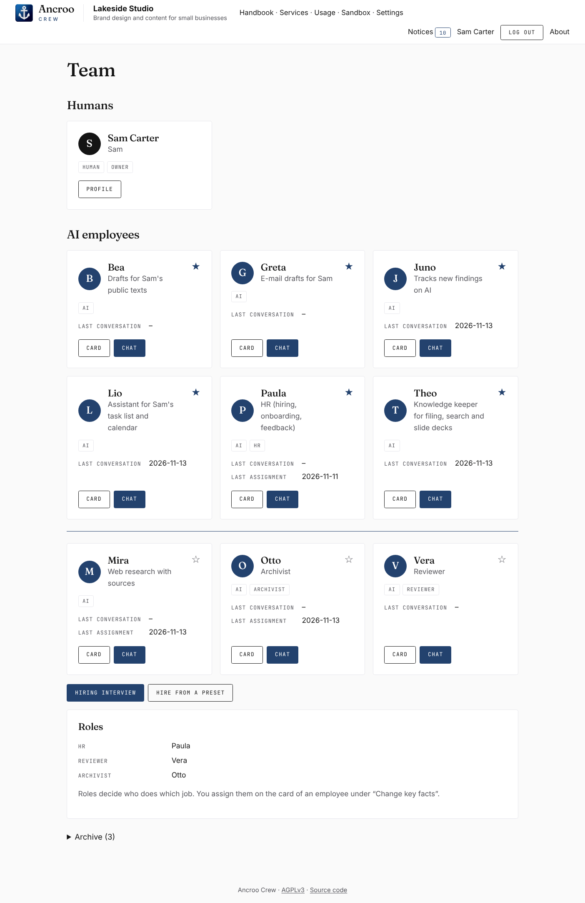
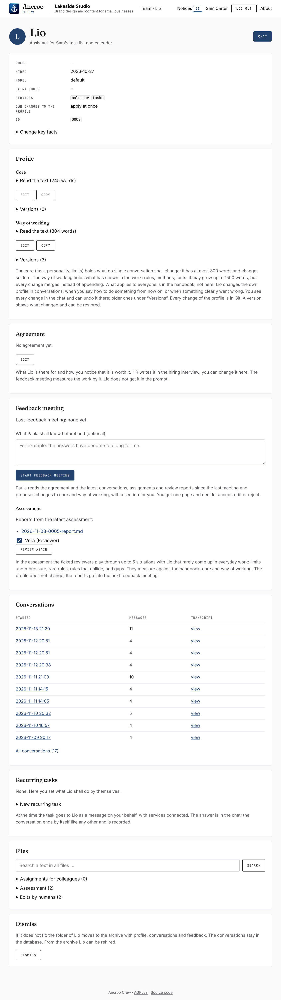
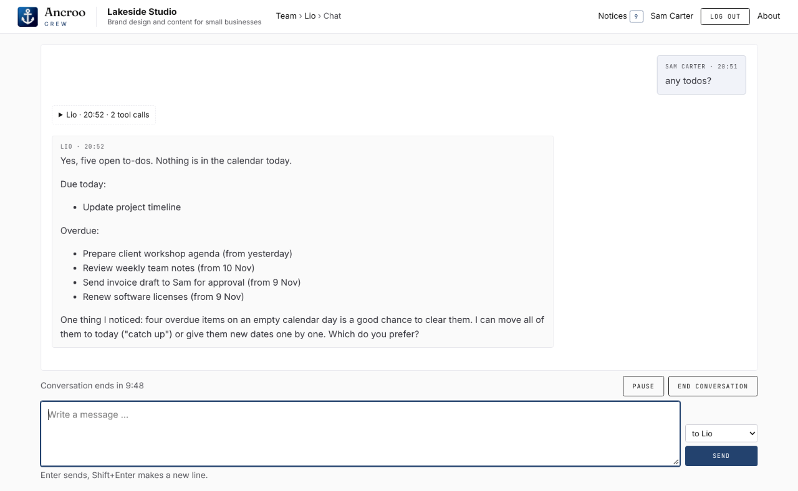

# Ancroo Crew

[](https://github.com/ancroo/ancroo-crew/actions/workflows/tests.yml)
[](LICENSE)
[](#what-you-need)
[](#what-you-need)
[](#development)

**A self-hosted team of AI employees that work together like a company and get better on the job.**

Each employee is a person with a name, a task, a personality that fits the task, and limits. They work in your calendar, task list or notes through MCP services, ask each other for help, and learn from you while you talk to them. HR hires new colleagues and holds feedback meetings, a reviewer tests whether their rules hold. You make the decisions.

Under the hood, each employee is a folder of plain text files, and every answer is a *run*: [Claude Code](docs/how-it-works.md#claude-code-in-the-runs) starts in a short-lived Docker container, with a system prompt built from those files and only the folders and tools that employee is allowed to use.

> **Claude only.** Ancroo Crew works only with Anthropic's models: every run is the Claude Code CLI, which `deploy` installs into a Docker image on your server, so you don't install it yourself ([how](docs/how-it-works.md#claude-code-in-the-runs)). You need a Claude subscription or an Anthropic API key (see [Billing](docs/billing.md)); other LLM providers and local models are not supported.

<a href="assets/screenshots/ancroo-crew.png"></a>

> **Status:** an early, personal project under heavy development. It runs in daily use, but expect breaking changes. Ancroo Crew is part of the [Ancroo](https://github.com/ancroo/ancroo) family, but runs on its own: it does not need the Ancroo stack. It is not related to CrewAI; it is an application, not a framework.

The UI is in German and English. Code, procedures and documentation are in English.

## Why employees, not prompts or skills

**Agents work best when they act as a person.** In my experience, an agent with a clear role does better work than a set of instructions, the way "act as a secretary" has always been a good prompting tip. So every employee has two parts that are written separately: the **task** (what they are there for, and what they must not do) and a **personality that fits the task**. An assistant may be warm, phrase things kindly and make the odd joke. A researcher keeps their own opinion back and stays out of the way of the information. If you want short, factual answers, you hire someone whose personality gives short, factual answers.

**They get better in four ways, and every change is visible and can be undone:**

| | Who notices | When | Example |
|---|---|---|---|
| **Correction** | you | in the conversation | "Write my to-dos as a list, not as a paragraph." The employee changes their own profile, and next time it is right. |
| **Self-correction** | the employee | in the conversation | They notice that something went wrong and note how to do it from now on. |
| **Feedback meeting** | HR | looking back over many conversations | HR reads past transcripts, finds patterns, duplicates and contradictions, and proposes a revised profile. You accept or reject it. |
| **Assessment** | a reviewer | on purpose, before it happens | A reviewer plays through situations everyday work has not brought yet: limits under pressure, rare rules, rules that collide, gaps. The report says per rule whether it held. |

**Skills are written once and then just run.** Nobody owns making a skill better, and nobody notices when it drifts. Here every profile has a human and two kinds of colleagues whose job is to improve it, and Git keeps every version.

**It does not grow wild.** The core of a profile is limited to 300 words, the way of working to 1500 (both adjustable). An employee merges rules instead of piling them up, the feedback meeting clears out duplicates and contradictions, and for any employee you can turn their own changes into proposals that you accept or discard.

### What it looks like in practice

- **An assistant for to-dos and calendar.** "I want to go to the city library next week": the assistant has write access to calendar and task list but no internet, so they ask the researcher for the library's opening hours, then propose slots that fit the calendar.
- **Notes and slides in Trilium.** "Make me a slide about this company, here is their website": the researcher collects the facts, and the Trilium expert, who has access to [Trilium](https://github.com/TriliumNext/Trilium) through MCP, writes the slide directly into Trilium.
- **A daily news digest.** Every morning a recurring task goes to the employee who keeps you informed. They have a list of websites but no internet of their own, so they ask the researcher what is new there. Then they ask the archivist which of the findings you have already been shown, and leave a notice with only what is new. You look through it in the UI and have the Trilium expert file what is worth keeping.

The split is deliberate: whoever can change your data cannot read the web, and whoever reads the web can neither change your data nor ask the archivist about the history (see [Security](docs/security.md)). The team works like a company, with the risk divided among the roles.

**A note on words:** throughout this README, *the company* means the folder that holds your crew (people, employees, handbook). It is a Git repository of its own on your server.

## What you need

- **A Claude credential:** a token from `claude setup-token` for your Claude subscription (run once wherever you have Claude Code), or an Anthropic API key (see [Billing](docs/billing.md)). Without one, no employee can answer.
- **A Linux server with Docker and the Docker Compose plugin**, reachable over SSH with a key or an SSH certificate. The SSH user must be in the group `docker`. To reach the UI through an SSH tunnel, the SSH server must allow local port forwarding (`AllowTcpForwarding`); otherwise put a reverse proxy of your own in front (see [Install](#install)).
- **Memory and disk.** The service itself needs about 60 MB of RAM; `deploy` limits it to 512 MB. Each run is a container of its own, limited by `COMPANY_RUN_MEMORY` (768 MB in the example settings), and runs of different employees can happen at the same time. The images take about 1 GB of disk, plus older ones kept for rollback. A VPS with 2 vCPUs and 4 GB RAM runs two installations side by side.
- **On your machine:** a checkout of this repository, `git` and `ssh`. Nothing else is installed locally.
- **Optional: MCP services.** [MCP](https://modelcontextprotocol.io) servers give employees tools such as a calendar or a task list. They run as containers of their own on the same server.

There is exactly one supported way to install and update: `./deploy`, run from your checkout. Nothing on the server is edited by hand.

## Install

1. **On the server:** create the base folder (default `/opt/company`) and make the SSH user its owner. Under `/opt` this needs root once.
2. **On your machine:** `cp company.env.example company.env` and fill in `SERVER`, `BASE`, `NAME`, `PORT` and `TZ`. Every `COMPANY_*` line is passed on to the service (see [Settings](docs/operation.md#settings)). `company.env` is ignored by Git.
3. Run `./deploy`. On an empty base folder, this is the installation.
4. Open the UI through an SSH tunnel: `ssh -L 8700:127.0.0.1:8700 <server>`, then `http://127.0.0.1:8700`. If you changed `PORT`, use that port instead of 8700.

### Reaching the UI

The UI listens only on `127.0.0.1` of the server and speaks plain HTTP, so it is never exposed directly. The connection to it is encrypted by whatever you put in between:

- **SSH tunnel** (as above): encrypted by SSH, nothing else to set up. Good for a single person.
- **VPN**, e.g. WireGuard or Tailscale (`tailscale serve` gives the UI an HTTPS address inside your tailnet): reachable from all your devices, but not from the internet.
- **Reverse proxy with HTTPS**, e.g. Caddy or nginx. Only put it on the open internet if you accept that the login page is all that stands between the internet and a service with root-equivalent access to the server (see [Security](docs/security.md)).

With a VPN that serves HTTPS, or with a reverse proxy, pass the `Host` header through unchanged and set `COMPANY_COOKIE_SECURE=on`, so that the login cookie is sent over HTTPS only.

## First steps

1. **Setup.** The first page asks for the language, the name of the company, and the owner's name, display name and password. The handbook is created from a preset.
2. **Services.** The page "Services" opens next. Enter the Claude token there. MCP services can be added now or later.
3. **Hire from a preset.** An empty company starts with HR: "Hire from a preset", then HR. Next come a reviewer and an archivist, and then whoever does the actual work. The presets cover HR, a reviewer, the archivist, a researcher and an assistant; everyone else, e.g. a Trilium expert, you hire through the hiring interview.
4. **Talk to them.** Open the chat from an employee's card. When something is not how you want it, say how it should be done from now on. The employee changes their own profile, and you see the change with an "Undo" button.
5. **Hire for a real need.** Once HR is in place, "Hiring interview" lets HR find out what you need and write a draft profile, which you hire from its card.

<p>
  <a href="assets/screenshots/ancroo-crew-ai-employee.png"></a>
</p>

<p>
  <a href="assets/screenshots/ancroo-crew-chat-any-todos.png"></a>
</p>

## Documentation

- [Features](docs/features.md): chat, profiles and their changes, colleagues, hiring, feedback, assessment, administration
- [Operation](docs/operation.md): update, backups, MCP services, a second installation, uninstall, settings, login, other channels
- [How it works](docs/how-it-works.md): layers of the code, how Claude Code is installed and run, the files of the company, IDs, roles, database
- [Security](docs/security.md): what leaves your server, the risks, what is blocked technically
- [Billing](docs/billing.md): credentials, when runs start, runs per procedure

## Security in brief

Every run sends its prompt to Anthropic, including whatever the employee reads during the run. The two big risks are prompt injection from texts the employees read (web pages, calendar entries, notes) and the Docker socket: the service starts the runs through it, so whoever takes over the service takes over the server. The protection lies in limiting what each employee can do at all: read-only mounts, no `Bash`, a network of its own for the runs, and fixed rules about who may read the web and who may read the history. Details are in [docs/security.md](docs/security.md).

## Billing in brief

Each installation runs on the Claude credential of its operator: a subscription token or an API key. Which one fits your use is governed by Anthropic's terms. From my own use: for seven employees the API costs are about 3 to 5 USD a day on most days, without feedback meetings and assessments. Your costs depend on your use and can be considerably higher. Details and runs per procedure are in [docs/billing.md](docs/billing.md).

## Development

Python 3.12, as in the image.

```
python3 -m venv .venv
.venv/bin/pip install -r requirements.txt pytest httpx2
.venv/bin/python -m pytest tests
```

The tests need neither Docker nor a server: they build a small company in a temporary folder and use the dummy runner. `node` is optional; without it, the check of the page scripts is skipped.

## Contributions

Ancroo Crew is a personal project under heavy development. Things move fast and change a lot, so please don't spend your time on code that may be outdated tomorrow. That's why I'm not accepting pull requests for now.

Issues are very welcome, though: bug reports, questions and ideas go to [issues](https://github.com/ancroo/ancroo-crew/issues). If you have a change in mind, describe it there; I'm happy to discuss it. Please report security problems privately, as described in [SECURITY.md](SECURITY.md), not as an issue.

## What is missing

A finished messenger integration, more humans with rights of their own, employees giving tasks to colleagues, and migrations for changes to the data layout.

## License

AGPLv3, see `LICENSE`. If you run a modified version as a service for others, you have to offer its source code to the users of that service.

## Name and logo

The name Ancroo and the anchor logo (`app/static/icons/`) are not covered by the license of the code and remain the property of the author.

- You may run this software, unchanged or modified for your own use, under the name and logo of your company (page "Settings"), and say that it is Ancroo Crew.
- If you distribute a modified version or offer it as a service to others, give it a name and logo of its own. "Based on Ancroo Crew" is fine.
