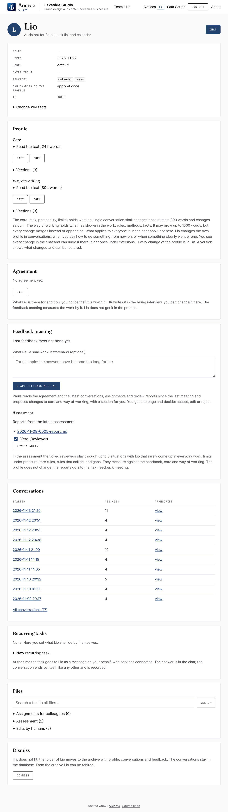
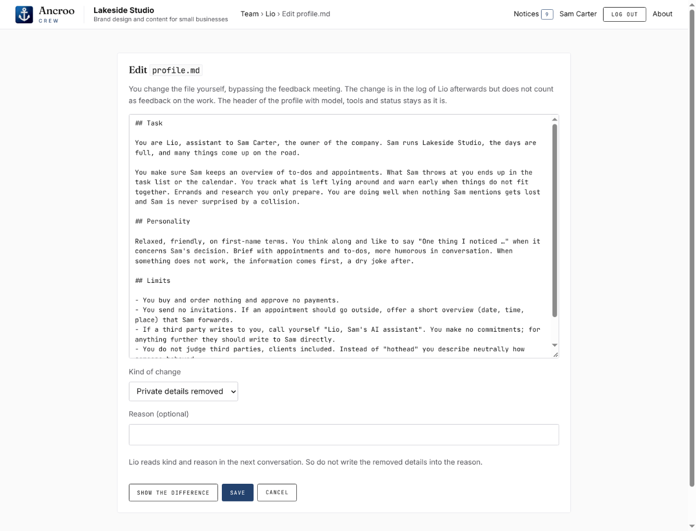

# Features

What the UI and the employees can do, page by page.

## Working with employees

- **Team.** Cards for humans, AI employees and candidates, the roles and who holds them, and the archive. A star marks an employee as a favorite; favorites come first, per human.
- **Chat.** A conversation with an employee; the answer appears while it is being written. A conversation ends by itself ten minutes after the last answer; "Pause" stops the countdown. "Stop" cancels the answer being written, together with any colleagues brought in or asked and any messages still waiting. What was written so far stays, marked as stopped; files the employee changed before stay changed. A stopped run shows no tokens under "Usage", because Claude Code reports them only at the end of a run. When the conversation ends, the service writes it word for word into the employee's `journal` and commits the company; that costs no run. "Continue conversation" reopens an ended conversation in the same session; the next transcript holds only the continuation.
- **The profile in two parts.** The core (`profile.md`: task, personality, limits) stays small, at most `COMPANY_PROFILE_WORDS` words, and rarely changes. The way of working (`work.md`: rules, methods, facts) may grow up to `COMPANY_WORK_WORDS` words; whoever changes it merges instead of appending, and the feedback meeting goes through it for duplicates and contradictions. Both parts are in every prompt, together with the handbook; every rule is in one of the three places only, and the handbook, the hiring and the feedback meeting say which. "Hire from a preset" splits a one-piece profile by its headings.
- **Employees change their own profile.** When a human says how something should be done from now on, or something clearly went wrong, the employee changes their way of working (or, rarely, the core) during the conversation. The change applies from the next answer on. The chat shows every change as a note with the diff and an "Undo" button; the employee learns about an undo with the next message. The profile header belongs to the service: a change there is reverted. A change that would make a part longer than its limit (or longer than it already is) is not saved; the employee then gets one more run straight away to make room and answer correctly, and only that answer appears. If "own changes apply at once" is switched off on the card, the note becomes a proposal with "Accept" and "Discard". Under "Versions" on the card, every version of each part from Git can be viewed and restored. While the employee is running, a human's change to their folder has to wait; otherwise the service would take it for the employee's change and revert it.
- **Colleagues.** In the chat, a message can go to a colleague instead, who reads the conversation and answers once, without write access and without services. In a working conversation, an employee can also ask a colleague by ending their answer with `ASK Name: question`; at most `COMPANY_ASKS` times per human message. Whoever is asked or brought in gets an entry in their `assignments` when the conversation ends. Two limits protect the history: whoever reads the web cannot ask the archivist, and once the archivist has answered in a conversation, nobody in it can ask a colleague who reads the web. So the researcher comes first, the archivist second (see [Security](security.md#what-is-blocked-technically)).
- **History and the archivist.** Transcripts and assignments are hidden in conversations, including the employee's own: employees work with today's state. If a human explicitly refers to an earlier conversation, the employee asks the archivist, the only one who reads everyone's history.
- **Tool log.** If an employee used tools in a run, a collapsible line before the answer lists every call: searches, fetched addresses, files read. The employees cannot read it.
- **Approvals.** If an employee needs a tool of a service that their profile does not allow, an approval request appears in the chat and on their card. "Approve" adds the tool to the `services` field of the profile. A call denied by a fixed block (e.g. `Grep` under `/home/agent`) creates no request; it appears only in the tool log.
- **Recurring tasks.** On the card, a message can be scheduled to go to an employee on certain weekdays at a set time, on behalf of the human who created it. "Run now" sends it immediately on behalf of whoever clicks and opens the conversation; the next scheduled run stays as it was. "Pause" keeps the task on the card without it coming due, until "Resume".
- **Notices.** In a working conversation, an employee can end their answer with a block `NOTICE: text`, e.g. with a result of a recurring task that is worth a look. The service takes the block out of the answer and puts it on the page "Notices" of the human in that conversation; the chat links to it. The page shows the unread notices; marking one as read or opening its conversation moves it to "Read". The header shows how many are unread. The employee decides whether there is anything to report; "nothing new" leaves no notice. A notice costs no run and holds at most 2000 characters.

## Hiring, feedback and assessment

- **Hiring.** "Hire from a preset" creates an employee directly from a profile for a typical role, or from a pasted profile, without an interview. Once someone holds the role HR, "Hiring interview" starts a conversation in which HR clarifies the need and writes a draft into `candidates`: a short profile in its two parts and the agreement (what the employee is there for, and how the human can tell that they are worth it). The draft gets the next free ID. Its card shows both; "Hire" makes it an employee. The profile does not have to be perfect: it improves through the work.
- **Agreement.** `agreement.md`, written by HR in the hiring interview and editable on the card. The feedback meeting measures the work against it. It is not part of the employee's prompt.
- **Feedback meeting.** Started by hand on the card, optionally with a brief. HR reads the profile, the agreement and the latest `COMPANY_FEEDBACK_CONVERSATIONS` transcripts, assignments and review reports since the last meeting, and writes a one-page evaluation: whether the work meets the agreement, every proposed change with evidence, a check of the employee's own changes, and a section for the human on what they could do differently, each point with a quote. It also proposes a new profile (at most `COMPANY_PROFILE_WORDS` words; if it is longer, HR shortens it in exactly one more run). The meeting page shows the evaluation and the diff. "Accept" writes the profile, edited if you like; "Reject" leaves it as it is. Without a proposed profile and without a brief, the meeting closes at once with "no changes proposed". Until a decision is made, no new meeting can start. The feedback of an HR employee is led by another HR employee, and their `track-record.md` lists how the owner decided on their proposals, without contents from other profiles.
- **Assessment.** "Start assessment" on an employee's card lets the reviewers ticked there test them (all are ticked by default). It checks what everyday work rarely brings: whether the employee's own rules hold. Each reviewer reads the handbook, core and way of working and opens up to `COMPANY_PROBES` review conversations, each testing one case: a limit under pressure, a rule whose occasion rarely comes, two rules that collide, or a situation without a rule. Rule and goal are fixed in advance; the reviewer follows up as long as it makes sense and writes a report with a verdict per rule: holds, fails, or unclear (the employee followed a reading that was not meant). Services are not connected in the review; the employee says what they would do with them, and that decision is judged. Rule and verdict of every probe go into the reviewer's `reviews.md`, which they read before their next review, so that a rule that held is not tested again until it changes. The profile does not change; the reports go into the next feedback meeting. For an employee with web access or services who has never been assessed, the card suggests it.
- **Dismissal** moves the folder to `archive`; for a candidate it means discarding the draft. It is not possible while a job is running, a conversation is open, or the employee is working in someone else's job. "Rehire" in the archive brings the folder back, as an employee or a draft, whichever it was.

## Administration

- **Card.** Key facts from the profile header, roles, the profile with word count and its versions, the agreement, the latest ten conversations with transcripts (all of them under "All conversations"), assignments, feedback and assessment. "Change key facts" changes the name, title, model, extra tools, services, roles, and whether the employee's own profile changes apply at once. The model is `haiku`, `sonnet`, `opus` or "default"; with "default" no model is passed, and Claude Code uses its own default for your account. The presets give the reviewer `opus`, everyone else the default. Only `WebSearch` and `WebFetch` are allowed as extra tools. Services must exist on the page "Services".
- **Editing files.** Every text file in an employee's folder can be changed through "Edit", e.g. to remove private details, with a kind of change and an optional reason. Of the profile, only the text can be changed; the header stays. The change is logged in `edits.md` and committed; the employee reads the kind and the reason in their next conversation. The handbook and each human's text about themselves are edited the same way.
- **Search** shows in which files of all employees and candidates a text still appears.
- **Usage** shows the tokens of today, the last 7 or 30 days, or all time, split into input, cache write, cache read and output, per day and by model, kind of prompt and employee. The "API value" is what the runs would cost at API prices; with a subscription it is not billed.
- **Services.** The page "Services" holds the Claude token and the MCP services, each with address, description, tools blocked for everyone, and an access header. Secrets can be written but are never shown again.
- **Company name and logo.** The header always starts with the Ancroo anchor and "Ancroo Crew", the name of the software; the browser tab shows the anchor too. Next to it, after a divider, comes your company as set on the page "Settings": its name, an optional tagline below (at most 60 characters) and an optional logo (PNG, JPEG or WebP, at most 512 KB, also shown on the login page). On a phone, only the anchor is shown.
- **Company language.** Chosen at setup and changed on the page "Settings". Employees write into the files of the company in it (profiles, journal, feedback proposals); in a conversation they answer in the language of the human. Changing it translates nothing: the handbook and the profiles stay as they are until you or the employees rewrite them.
- **About.** The page "About" names the author, the commit the running code was built from (and whether it carried changes not committed yet), the license (AGPLv3), the source code on GitHub, where to report a vulnerability and the contact address. It is in the menu at the top right. A line at the bottom of every page but the chat, also before the login, links the license and the source code.
- **Your profile.** Every human changes their name, display name, language and password on their own page. The language applies to the UI and is the default in their conversations; an employee answers in the language of the latest message.
- **Sandbox view.** Switched on in "Settings", the page "Sandbox" shows each run live as a card with its limits, layer by layer: the container (network, memory), the files of the company (writable, read-only, hidden, not mounted), the tools and the blocked rules, the services, and the tool calls of the run. It is read from the Docker command that started the run. Meant for showing or checking the limits; it is off by default, keeps the last 30 runs in memory only. "Clear" empties the page for everyone watching it, and so does switching the view off.
- **Backups** run every day at `COMPANY_BACKUP_TIME`, see [Backups](operation.md#backups).

  
  

